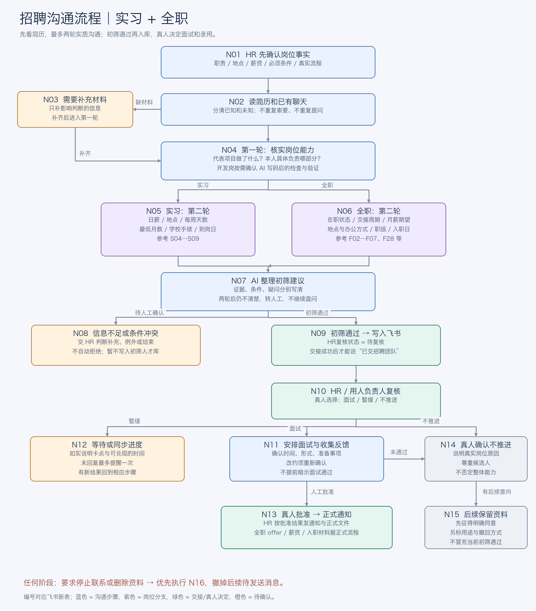
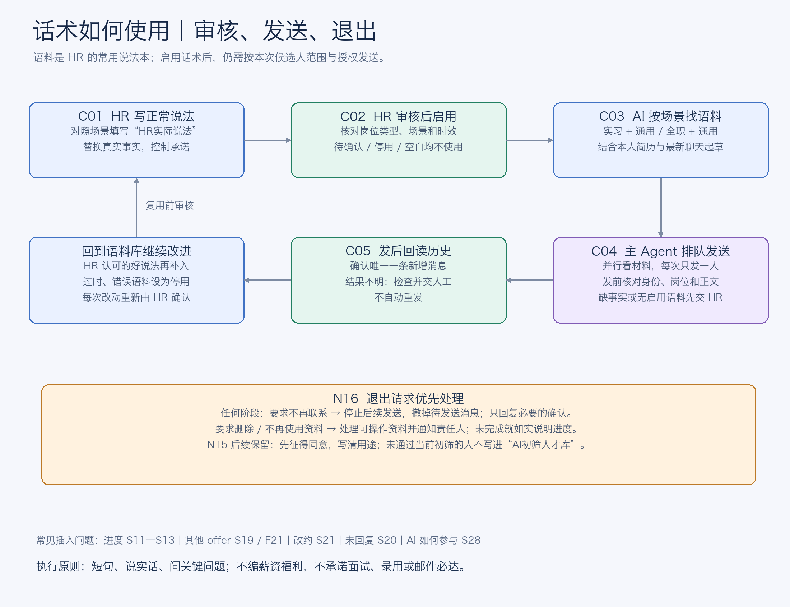
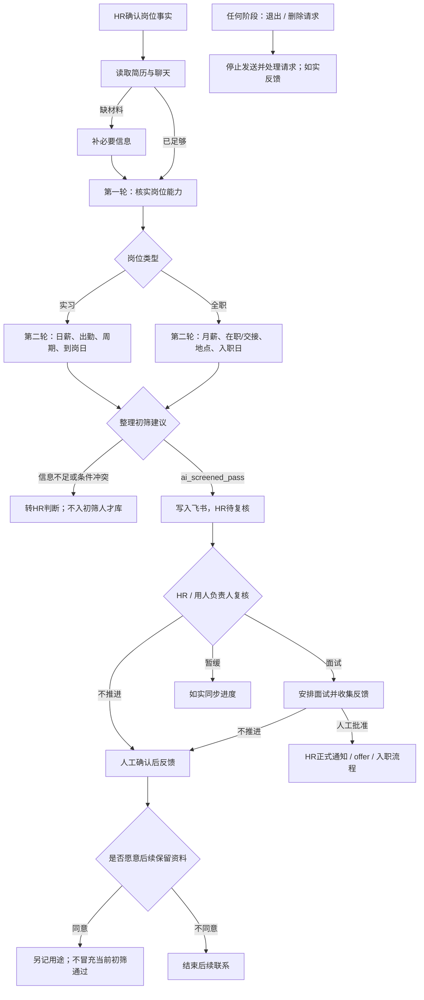

# 招聘沟通流程图（实习 / 全职）

根据现有58条HR语料整理。文中的100–120元/天仅对应最初实习岗示例，其他岗位单独核验。候选人发送按既有授权执行；本文件不启用自动招聘。

## N01 确认岗位事实

确认职责、岗位类型、地点、工作方式、预算、硬性条件及已批准流程。全职预算独立确认；不能套用实习日薪。

下一步：N02

回复要求：只回答已核验事实；薪资、制度、流程不明确时先问 HR。

## N02 读简历和已有聊天

识别当前岗位和候选人；读取简历附件、在线简历及聊天；区分已知事实和未知信息，避免重复提问。

下一步：材料缺失→N03；已足够→N04

回复要求：简短确认收到。仅看过后才能说“已经看过”；具体回复日期须可兑现。

## N03 补充必要材料

仅补与判断有关的信息；不把附件作为一律拒绝的门槛，不重复索要已收到的简历。

下一步：补齐→N04；未回复→N12；不确定→N08

回复要求：说清想看哪部分；表述不清先确认理解。

## N04 第一轮：核实岗位能力

实习生围绕掌握的技术、工具、本人负责功能和独立完成范围了解能力，不要求验证代码、做题或提供验证材料。相关竞赛获奖单列证明加分并标注来源；GitHub 只计本人可归因贡献，fork 上游原代码不计分；全职按真实岗位需求沟通。首次开场直接“你好”，不加用户名。

下一步：实习→N05；全职→N06

回复要求：一次抓一个关键点；已有证据不再追问；不把聊天变成技术面试。

## N05 第二轮：实习到岗条件

核实日薪、地点、每周出勤天数、最低实习月数、学校手续和最快到岗日期。当前已确认实习日薪为100–120元/天；其他要求随具体岗位核验。

下一步：N07

回复要求：按尚未确认的信息提问；接受最低周期就不另抬要求。

## N06 第二轮：全职入职条件

核实在职状态、交接周期、月薪期望、地点/办公方式、职级方向和最快入职日。已回答的不重问；其他 offer 时限按需确认。

下一步：N07

回复要求：全职月薪、薪资结构、工时、试用期、福利均按 HR 已确认信息回答；未知就记录待确认。

## N07 整理初筛建议

整理能力证据、条件确认项、未知项及建议。证据和条件足够支持初筛通过时标记 ai_screened_pass；否则待人工确认。

下一步：证据不足/冲突→N08；初筛通过→N09

回复要求：不把评分说成录用结论；不拿年龄、性别等无关信息替代岗位能力判断。

## N08 信息不足或条件冲突

保留疑问交人工判断；两轮后不持续追问。此时不写入“AI初筛人才库”，也不自动发送拒绝通知。

下一步：补证后重看N07；人工不推进→N14；等待→N12

回复要求：只说已经确认的岗位差异；最终不推进须有人确认。

## N09 通过初筛后入库

写入或更新飞书人才库：岗位、薪资、岗位相关证据、简历链接、到岗安排与待确认项；HR复核状态保持待复核。核对写入成功。

下一步：N10

回复要求：只有真实入库并完成交接后，才能说“已整理给招聘团队复核”；联系渠道据实际情况，不承诺邮件必达。

## N10 HR 复核并选下一步

看简历、证据、条件和 AI 建议，决定面试、暂缓或当前岗位不推进。

下一步：面试→N11；暂缓→N12；不推进→N14

回复要求：只同步已被真人确认的状态。

## N11 安排面试并收集反馈

确认时间和形式、准备事项；改约后重新确认，迟到先了解情况。面试后整理人工反馈。

下一步：人工通过→N13；不推进→N14；未定→N12

回复要求：不用“走个流程”“基本稳了”；面试安排以最终确认信息为准。

## N12 等待、催进度与一次提醒

明确实际卡点；只有可兑现时才约定更新时间。候选人未回复最多提醒一次；有其他 offer 则确认其决策时限并转达团队。

下一步：恢复沟通→原节点；新人工结论→N11/N13/N14；退出→N16

回复要求：不编反馈周期，不要求对方拒绝其他 offer。

## N13 真人批准后正式通知

按已批准阶段发正式通知；全职 offer、薪资、试用期、入职材料和核验要求按正式流程执行。

下一步：按正式入职流程跟进；候选人退出→N16

回复要求：不能把“进入下一轮”说成“已录用”；不能先口头承诺未经批准的待遇。

## N14 真人确认不推进

用简洁、尊重的表达同步真实岗位原因；不否定候选人整体能力。

下一步：当前岗位结束；拟后续联系→N15；要求停止→N16

回复要求：只讲真实、已确认的岗位原因；不自动拒绝。

## N15 征求后续保留同意

先征得明确同意，记录保留用途及撤回方式；未来储备单独标记，不能伪装成当前岗位初筛通过记录。未同意不进入后续联系安排。

下一步：同意→按已约定用途保留；拒绝/撤回→N16

回复要求：保留不等于有未来岗位或一定会联系。

## N16 停止联系或删除请求

立即停止后续发送；按请求处理可操作资料并通知相关责任人。删除未完成时如实报进度，不先声称全部删完。

下一步：退出当前沟通；删除未完则人工跟进到有结果

回复要求：停止请求优先于催促、排队消息和流程推进。

## C01 HR 填写正常说法

找到对应岗位类型与场景，在“HR实际说法”填入自然、简短的表达；替换变量，核对岗位事实。

下一步：C02

回复要求：AI建议话术只是草稿；不直接当已批准口径。

## C02 审核后设为启用

确认适用岗位、场景、时效、事实和承诺后，将审核状态改成启用；过时语料改停用。

下一步：C03

回复要求：待确认、停用、HR实际说法为空的记录都不能当作已批准语料。

## C03 按场景检索并起草

实习检索“实习+通用”，全职检索“全职+通用”；只使用已启用且实际说法非空的语料。结合本人最新聊天和简历替换事实。

下一步：C04；缺口径/无启用语料→交 HR 审稿

回复要求：借鉴语气和结构，不复制其他候选人的事实；无语料时只生成待审草稿。

## C04 核对后按顺序发送

重新读取会话；确认 UID、姓名、岗位和最终文本。各候选人可并行研究，主 Agent 持全局发送锁，一次只发一人。

下一步：C05；发送前退出→N16

回复要求：话术启用不等于授权给所有人群发；仍按当前候选人范围和审批执行。

## C05 发后回读并记录

回读聊天历史，核对唯一新增消息。结果不明先检查，不自动重发。把经 HR 确认的好说法补充回语料库。

下一步：已确认发送→返回当前流程；新说法→C01；结果不明→人工确认

回复要求：只有历史核验成功才记录已发送。
